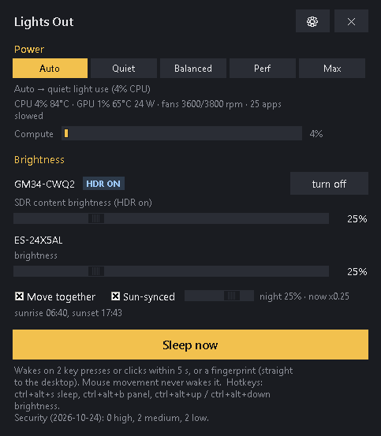
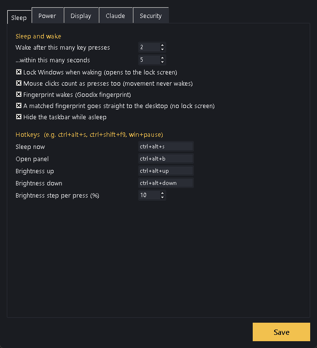
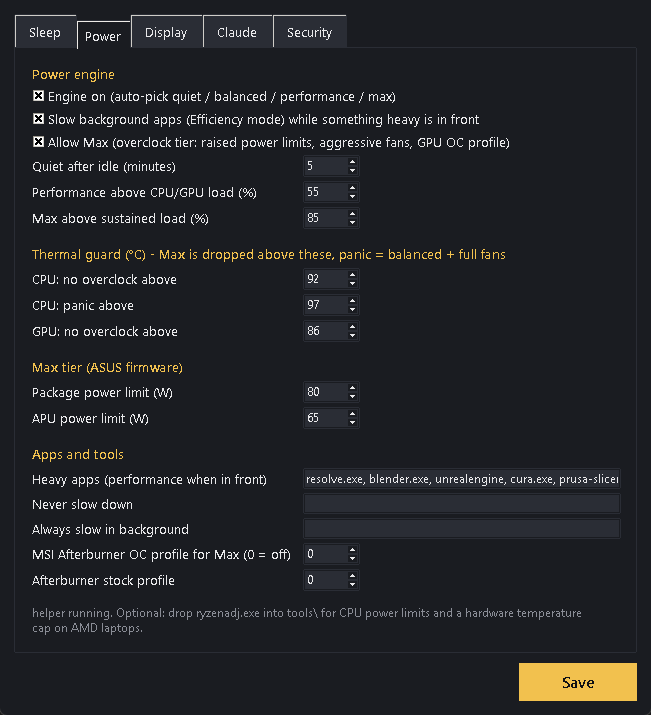
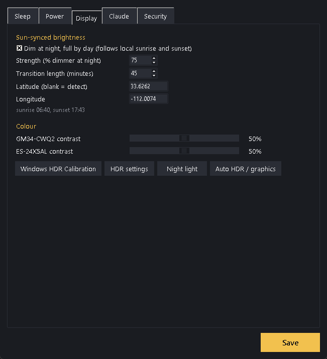
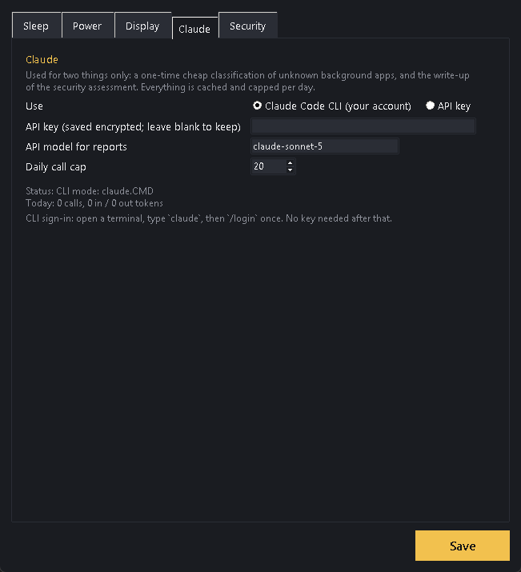
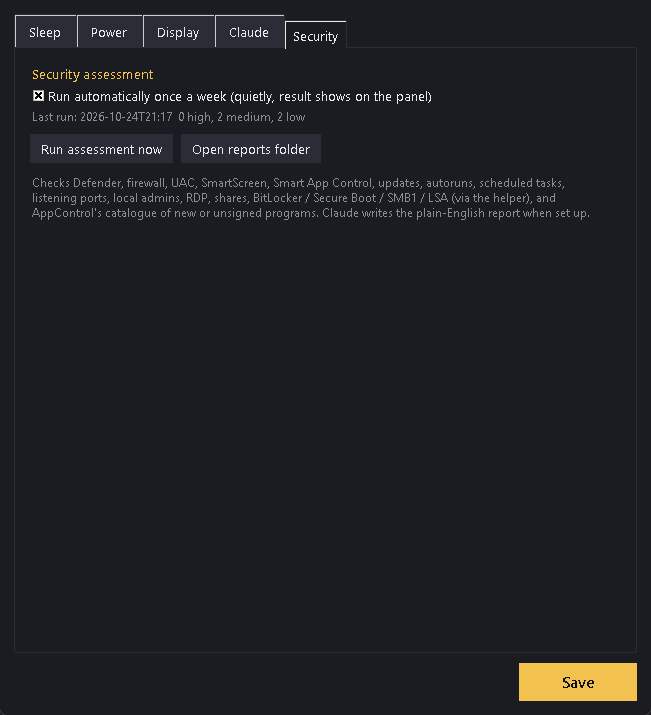
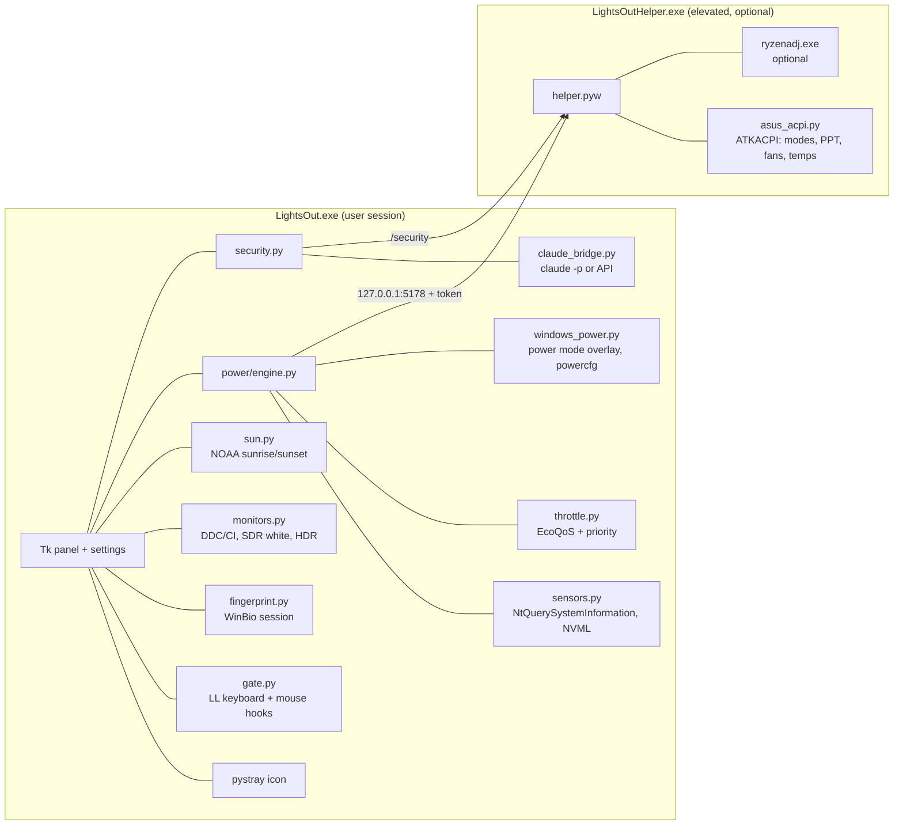

# Lights Out

A tray app for a Windows desk that does the things the OS makes awkward:
monitor brightness that follows the sun, a sleep mode the mouse cannot wake,
a power engine that picks the right performance profile by watching what you
are doing, and a security check written up in plain English by Claude.

Pure Python, no framework, no service bus. Idles at **0.04 % CPU** (0.7 % of
one core) and 74 MB. Runs on any Windows 10/11 PC; the firmware-level parts
light up where the hardware has them. See [REVIEW.md](REVIEW.md) for an
honest engineering review with measurements.

<p align="center"></p>

## What it does

**Brightness.** One slider per monitor driving the real backlight over
DDC/CI (laptop panels over WMI). On an HDR monitor the backlight is pinned
by HDR mode, so the slider drives Windows' *SDR content brightness* instead,
which is what actually dims the desktop. HDR on/off button included. Click or
drag anywhere on the track; the wheel steps 5 %.

**Sun-synced.** Tick the box, set a strength, done. Sunrise and sunset are
computed locally from your location (detected once, or typed in), the level
you set by day is scaled down at night by the strength you chose, with a
smooth transition around dawn and dusk.

**Sleep.** Windows locks, every monitor goes black, brightness to 0, then
DDC/CI standby; the taskbar hides; the PC is held awake so Windows' own sleep
never kicks in. **Wake** = signing in (Windows Hello fingerprint or password)
brings the screens back, and so do two presses within five seconds, where a
press is any key or any mouse button (movement never counts). If the screens
come on and nobody signs in, they go dark again after three minutes. Locking
at sleep is a switch in Settings; off, the desktop stays unlocked behind the
black screens, keys and clicks are swallowed, the app's own fingerprint
session wakes it, and Windows is locked on the way out instead.

**Safety net.** While asleep the tray app heartbeats to the helper. If it
ever dies or hangs, the helper locks Windows, shows the taskbar, wakes the
monitors and restores brightness within about ten seconds; a fresh start does
the same from a sentinel file; and a hang dumps every thread's stack to
`crash.log`.

**Power engine.** Every two seconds it samples CPU, GPU, temperatures, fans,
battery, idle time, the foreground app (fullscreen? on the GPU?) and the
heaviest processes, then picks a profile with hysteresis so it never flaps:

| profile | Windows power mode | plan boost mode | background apps | ASUS firmware |
|---|---|---|---|---|
| quiet | best efficiency | efficient | known hogs slowed | silent |
| balanced | balanced | efficient | known hogs slowed | balanced |
| performance | best performance | aggressive | all slowed | turbo |
| max | best performance | aggressive at guaranteed | all slowed | turbo + raised PPT + fan curve (+ GPU OC profile) |

"Slowed" is Windows 11's own Efficiency mode (EcoQoS plus a lower priority)
applied to your background processes while something heavy is in front,
never to the foreground app, audio, capture, input or shell processes, and
undone when the profile relaxes. **Max** is the overclock tier and only runs
while temperatures are under the guard limits; above them it is dropped at
once, and a CPU panic temperature means balanced plus full fans. Pick a
profile by hand to pin it; the guard still applies.

**Security assessment.** Defender, firewall, UAC, SmartScreen, Smart App
Control, updates, autoruns, scheduled tasks, listening ports, local admins,
RDP, PowerShell policy, shares, BitLocker, Secure Boot, SMB1, LSA protection,
TPM, plus the catalogue of a third-party app allow-lister if present
(AppControl: new or unsigned programs that ran this week). Rule-based scoring
first; Claude turns the compact JSON into a short prioritised report when it
is set up. Weekly by default.

**Claude.** Used for two things only: a one-time, cached classification of
unknown heavy background apps (so nothing important gets slowed) and the
security write-up. Either the Claude Code CLI on the machine, billed to your
account, or an API key stored DPAPI-encrypted. Daily call cap and a usage
counter in Settings.

## Screenshots

| Sleep | Power | Display |
|---|---|---|
|  |  |  |

| Claude | Security |
|---|---|
|  |  |

## How it is put together



Everything that needs the desktop lives in one process; everything that
needs admin lives in a tiny helper that sleeps on a loopback socket. Runtime
data (config, state, logs, reports) goes to `%LOCALAPPDATA%\LightsOut`.

## Install

**Packaged:** download `LightsOut.zip` from Releases (or run `python build.py`
to make it), unzip anywhere, double-click **Install Lights Out.bat** (one UAC
prompt). That registers the elevated helper task, adds a Desktop shortcut,
sets the app to start at logon (HKCU Run key) and starts it. **Uninstall
Lights Out.bat** reverses it. Each launch leaves a breadcrumb in
`%LOCALAPPDATA%\LightsOut\startup.log`.

**From source:** Python 3.12, `pip install -r requirements.txt`, then
`pythonw lightsout.pyw`. The same bat works from a checkout.

Optional add-ons picked up automatically: `tools\ryzenadj.exe` (AMD laptops:
power limits and a hardware temperature cap for the max tier) and MSI
Afterburner in its default folder for GPU clock profiles.

Hotkeys out of the box: `Ctrl+Alt+S` sleep, `Ctrl+Alt+B` panel,
`Ctrl+Alt+Up` / `Ctrl+Alt+Down` brightness on every monitor. All editable.

## Verify it yourself

```
python lightsout.pyw --selftest   # hotkey opens the panel, engine has a profile, sleep hides the taskbar and arms
                                  # the fingerprint reader, two clicks wake, sleep, two key taps wake, brightness restored
python panel_shot.py              # screenshots of the panel and every settings tab into docs\
python security.py                # collectors + scoring without Claude
python fingerprint.py             # arms the reader for 8 s: touch it to see it fire
python -m power.procsnap          # the 5 ms process snapshot
```
Stop the tray instance first; the self-test only opens its panel otherwise.

## Things learned the hard way

- Windows' own display-off and sleep put this laptop into Modern Standby
  that never wakes. Nothing here touches Windows' power state; sleep mode
  talks to the monitors' own controllers and holds `ES_SYSTEM_REQUIRED`.
- dxva2 physical-monitor handle **0 is a valid handle**. Never test it for truth.
- An HDR monitor can accept the DDC brightness command and change nothing.
- Low-level keyboard hooks do not see the lock screen, so lock on wake.
- psutil's per-process CPU reading costs ~850 ms for 300 processes on
  Windows; one `NtQuerySystemInformation` call costs 5 ms.
- The boost-mode power-plan setting is hidden from `powercfg /query`; read it
  from the registry under `Control\Power\User\PowerSchemes`.
- `RegisterHotKey` needs a thread that pumps messages, and that thread must
  create its queue before anyone posts to it.
- `WinBioOpenSession` on the system fingerprint pool works without elevation,
  `WinBioIdentify` blocks until a touch, `WinBioCancel` unblocks it.
