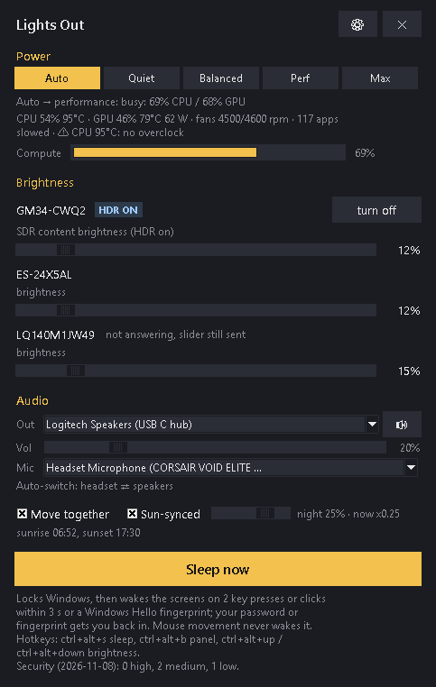
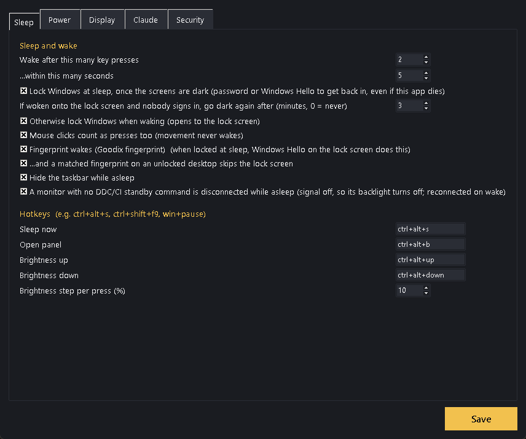
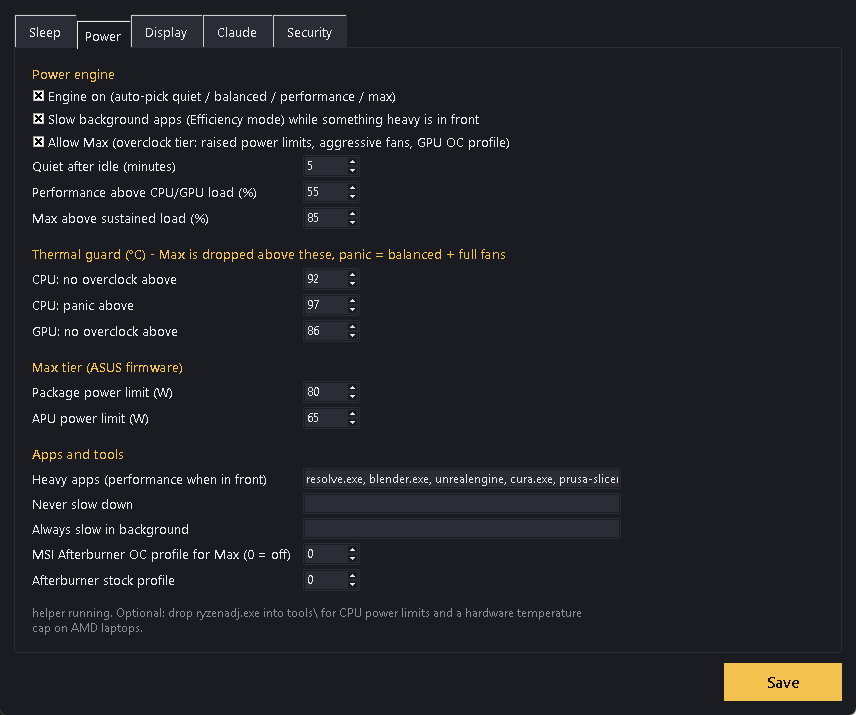
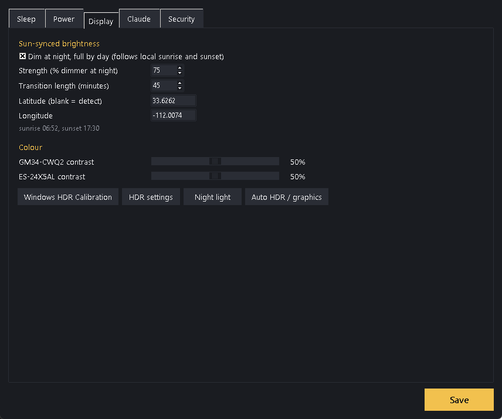
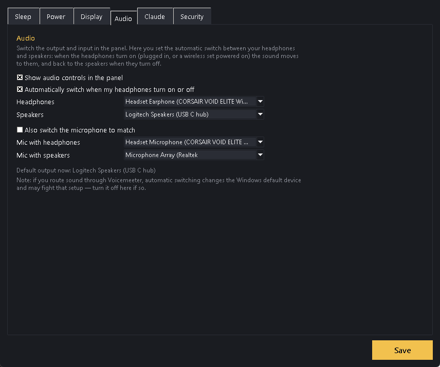
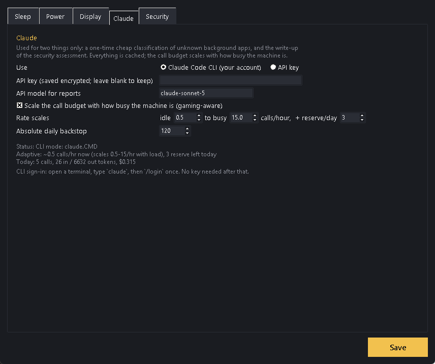
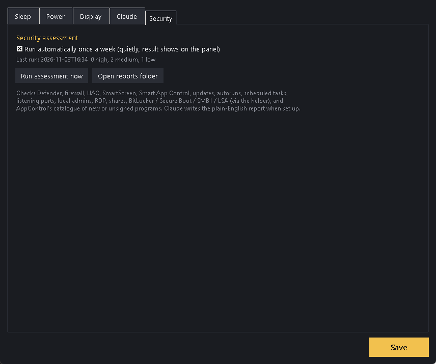
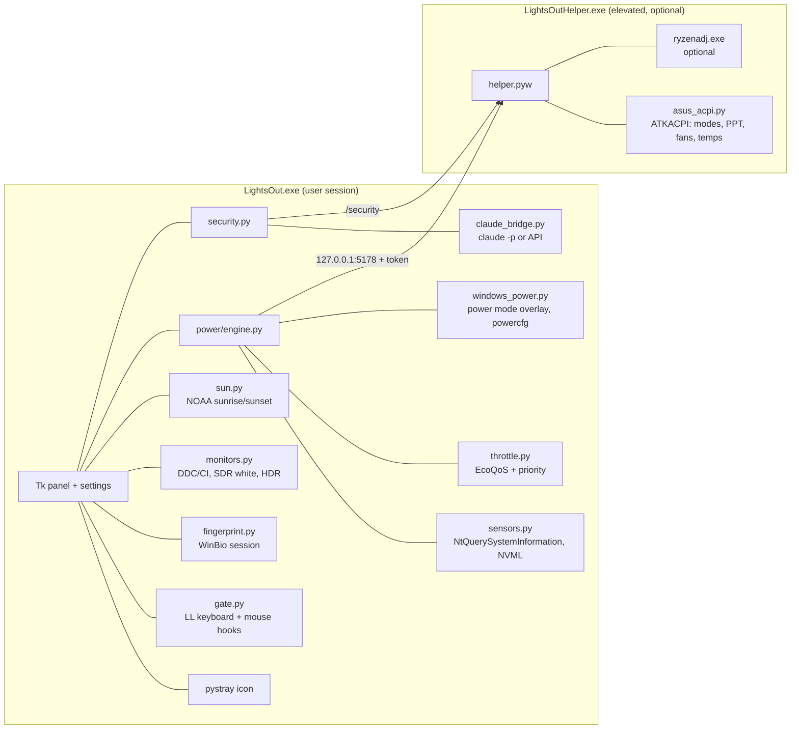

# Lights Out

A tray app for a Windows desk that does the things the OS makes awkward:
monitor brightness that follows the sun, a sleep mode the mouse cannot wake,
a power engine that picks the right performance profile by watching what you
are doing, and a security check written up in plain English by Claude.

Pure Python, no framework, no service bus. Idles at **0.04 % CPU** (0.7 % of
one core) and 74 MB. Runs on any Windows 10/11 PC; the firmware-level parts
light up where the hardware has them. See [REVIEW.md](REVIEW.md) for an
honest engineering review with measurements.

<p align="center"></p>

## What it does

**Brightness.** One slider per monitor driving the real backlight over
DDC/CI (laptop panels over WMI). On an HDR monitor the backlight is pinned
by HDR mode, so the slider drives Windows' *SDR content brightness* instead,
which is what actually dims the desktop. HDR on/off button included. Click or
drag anywhere on the track; the wheel steps 5 %.

**Sun-synced.** Tick the box, set a strength, done. Sunrise and sunset are
computed locally from your location (detected once, or typed in), the level
you set by day is scaled down at night by the strength you chose, with a
smooth transition around dawn and dusk.

**Audio.** Pick the output and input device right in the panel, with a volume
slider and a mute button, so you never dig through the Sound settings. The
smart part: name your headphones and your speakers once, and the default output
follows them automatically. When the headphones turn on (plugged into the jack,
or a wireless set powered on) sound moves to them, and back to the speakers
when they turn off. The microphone can follow the same way. Device switching
uses the same endpoint call the Sound control panel does; detection is a light
poll of the audio endpoints, no driver or service.

**Taskbar strip.** The everyday controls sit at the left end of the taskbar
(empty on a centred Windows 11 taskbar): a Sleep button, one brightness slider
for every monitor, a power-mode slider and live CPU / memory / GPU readings,
with the AI agents' share when they are busy. Windows 11 has no API for putting
controls inside the taskbar, so it is a borderless, never-activating window
that keeps itself directly above the taskbar (the taskbar's own menus still
draw over it), follows it when it moves, and hides with it: during sleep,
auto-hide, or when a fullscreen app covers it.

**Sleep.** Every monitor goes dark first and Windows locks after, so the
lock screen is never drawn on a lit panel: brightness to 0, then DDC/CI
standby where the monitor implements it. A monitor with no standby command
(it acknowledges the write and ignores it) is disconnected instead, the way
Settings > "Disconnect this display" does, which is the only thing that turns
such a backlight off; on wake it is reconnected with its position, HDR and
brightness exactly as before. A monitor that accepts DDC/CI standby but then
ignores the power-on command (some do, so you would have to power-cycle it by
hand) is woken the same reliable way: its video signal is briefly dropped and
restored, which powers the backlight back on as if it were replugged, while
another display keeps the desktop up. The taskbar hides; the PC is held awake
so Windows' own sleep never kicks in. **Wake** = signing in (Windows Hello fingerprint or password)
brings the screens back, and so do two presses within five seconds, where a
press is any key or any mouse button (movement never counts). If the screens
come on and nobody signs in, they go dark again after three minutes. Locking
at sleep is a switch in Settings; off, the desktop stays unlocked behind the
black screens, keys and clicks are swallowed, the app's own fingerprint
session wakes it, and Windows is locked on the way out instead.

**Remote desktop.** If a Chrome Remote Desktop client connects while asleep,
the main monitor comes on at 16:9 (an ultrawide is awkward to remote into) and
the others stay off, so there is a clean single display to work on. Windows
stays locked — you sign in once through the remote session; the app never
stores or types your password and never bypasses the lock. The power engine
comes back to life so a remote gaming or work session scales normally. When the
session ends, or a real key is pressed at the desk ("switched to manual"), it
locks and goes back to the dark sleep state. The connect and disconnect are read
straight from the CRD host's own entries in the Windows event log; a keystroke
is known to be local because Remote Desktop types with injected input, which the
keyboard hook can tell from a key pressed at the desk.

**Displays that are off stay off.** A monitor that is switched off in Settings
when the desk goes to sleep is never turned on by waking, even if Windows
brought it up in between. You can also keep the laptop's own screen off
whenever another monitor is connected (never when it is the only one), and on
a desk where no monitor can stay connected dark, that switched-off panel can
hold the desktop while asleep so the real monitors can all turn off; waking
switches it off again.

**Power mode resets on sleep.** A mode pinned by hand - Max for a game, say -
lasts one session: going to sleep puts the engine back on Auto (a switch in
Settings > Sleep).

**Safety net.** While asleep the tray app heartbeats to the helper. If it
ever dies or hangs, the helper locks Windows, shows the taskbar, wakes the
monitors and restores brightness within about ten seconds; a fresh start does
the same from a sentinel file; and a hang dumps every thread's stack to
`crash.log`.

**Power engine.** Every two seconds it samples CPU, GPU, temperatures, fans,
battery, idle time, the foreground app (fullscreen? on the GPU?) and the
heaviest processes, then picks a profile with hysteresis so it never flaps:

| profile | Windows power mode | plan boost mode | background apps | ASUS firmware |
|---|---|---|---|---|
| quiet | best efficiency | efficient | known hogs slowed | silent |
| balanced | balanced | efficient | known hogs slowed | balanced |
| performance | best performance | aggressive | all slowed | turbo |
| max | best performance | aggressive at guaranteed | all slowed | turbo + raised PPT + fan curve (+ GPU OC profile) |

"Slowed" is Windows 11's own Efficiency mode (EcoQoS plus a lower priority)
applied to your background processes while something heavy is in front,
never to the foreground app, audio, capture, input or shell processes, and
undone when the profile relaxes. **Max** is the overclock tier and only runs
while temperatures are under the guard limits; above them it is dropped at
once, and a CPU panic temperature means balanced plus full fans. Pick a
profile by hand to pin it; the guard still applies.

**Agent governor.** AI coding agents (several Claude Code sessions, each
running builds, tests and scans) will take every core, and a browser - which
runs its own tabs below normal priority - loses to them. The sessions are
separate process trees that know nothing of each other, so the engine
coordinates them from outside. Every process descended from an agent always
runs below normal priority with low I/O and memory priority (free when the
machine is idle, an instant yield when it is not). While you are using the PC
and the agent app is not in front, the trees are also confined to a share of
the logical CPUs (35 % kept free by default) and marked for efficiency under
heavy load; when you are away, asleep, or looking at the agent itself, the
ceiling comes off. Held-back agent work no longer counts when the engine picks
a profile, so background agents cannot push the machine into the overclock
tier. Measured with 16 extra CPU burners on top of running sessions: a
normal-priority task outside the agent trees went from 18.2 s (machine at
100 %) to 4.8 s (machine at 71 %).

**Security assessment.** Defender, firewall, UAC, SmartScreen, Smart App
Control, updates, autoruns, scheduled tasks, listening ports, local admins,
RDP, PowerShell policy, shares, BitLocker, Secure Boot, SMB1, LSA protection,
TPM, plus the catalogue of a third-party app allow-lister if present
(AppControl: new or unsigned programs that ran this week). Rule-based scoring
first; Claude turns the compact JSON into a short prioritised report when it
is set up. Weekly by default.

**Claude.** Used for two things only: a one-time, cached classification of
unknown heavy background apps (so nothing important gets slowed) and the
security write-up. Either the Claude Code CLI on the machine, billed to your
account, or an API key stored DPAPI-encrypted. The call budget is adaptive: it
scales with how busy the machine is, from a floor when idle (0.5/hour plus a
small daily reserve) up to a ceiling during a gaming or heavy session
(15/hour), so classifications keep up when profiles are changing fast and cost
almost nothing when they are not. An absolute daily backstop and a usage
counter sit in Settings, and the whole thing can be switched back to a flat
daily cap.

## Screenshots

| Sleep | Power | Display |
|---|---|---|
|  |  |  |

| Audio | Claude | Security |
|---|---|---|
|  |  |  |

## How it is put together



Everything that needs the desktop lives in one process; everything that
needs admin lives in a tiny helper that sleeps on a loopback socket. Runtime
data (config, state, logs, reports) goes to `%LOCALAPPDATA%\LightsOut`.

## Install

**Packaged:** download `LightsOut.zip` from Releases (or run `python build.py`
to make it), unzip anywhere, double-click **Install Lights Out.bat** (one UAC
prompt). That registers the elevated helper task, adds a Desktop shortcut,
sets the app to start at logon (HKCU Run key) and starts it. **Uninstall
Lights Out.bat** reverses it. Each launch leaves a breadcrumb in
`%LOCALAPPDATA%\LightsOut\startup.log`.

**From source:** Python 3.12, `pip install -r requirements.txt`, then
`pythonw lightsout.pyw`. The same bat works from a checkout.

Optional add-ons picked up automatically: `tools\ryzenadj.exe` (AMD laptops:
power limits and a hardware temperature cap for the max tier) and MSI
Afterburner in its default folder for GPU clock profiles.

Hotkeys out of the box: `Ctrl+Alt+S` sleep, `Ctrl+Alt+B` panel,
`Ctrl+Alt+Up` / `Ctrl+Alt+Down` brightness on every monitor. All editable.

## Verify it yourself

```
python lightsout.pyw --selftest   # hotkey opens the panel, engine has a profile, sleep hides the taskbar and arms
                                  # the fingerprint reader, two clicks wake, sleep, two key taps wake, brightness restored
python panel_shot.py              # screenshots of the panel and every settings tab into docs\
python security.py                # collectors + scoring without Claude
python fingerprint.py             # arms the reader for 8 s: touch it to see it fire
python -m power.procsnap          # the 5 ms process snapshot
```
Stop the tray instance first; the self-test only opens its panel otherwise.

## Things learned the hard way

- Windows' own display-off and sleep put this laptop into Modern Standby
  that never wakes. Nothing here touches Windows' power state; sleep mode
  talks to the monitors' own controllers and holds `ES_SYSTEM_REQUIRED`.
- dxva2 physical-monitor handle **0 is a valid handle**. Never test it for truth.
- An HDR monitor can accept the DDC brightness command and change nothing.
- A monitor can accept the DDC/CI standby command and ignore it too. The
  capabilities string says whether `D6` is really there (the GM34-CWQ2's is
  not); without it only cutting the video signal turns the backlight off, and
  `SetDisplayConfig` can do that for one monitor and put it back unchanged.
- Low-level keyboard hooks do not see the lock screen, so lock on wake.
- psutil's per-process CPU reading costs ~850 ms for 300 processes on
  Windows; one `NtQuerySystemInformation` call costs 5 ms.
- The boost-mode power-plan setting is hidden from `powercfg /query`; read it
  from the registry under `Control\Power\User\PowerSchemes`.
- `RegisterHotKey` needs a thread that pumps messages, and that thread must
  create its queue before anyone posts to it.
- `WinBioOpenSession` on the system fingerprint pool works without elevation,
  `WinBioIdentify` blocks until a touch, `WinBioCancel` unblocks it.
- Chrome Remote Desktop logs every connect (event ID 1) and disconnect (ID 2)
  to the Application event log under provider `chromoting`; `EvtSubscribe` in
  pull mode turns that into a push signal with no polling and no log tailing.
- A remote client types with injected input (`LLKHF_INJECTED`); a key pressed at
  the desk is not flagged, which is the whole basis for telling a person taking
  over from the remote user's own typing.
- A process started from inside a packaged (MSIX) app - a terminal or an agent
  hosted by one - inherits its container: new files under `%LOCALAPPDATA%` land
  in a private per-package copy, and the process dies when the host app closes.
  An instance started that way and one started normally then disagree about
  config, logs, the sleep state and the helper's token (HTTP 403 for ever). The
  app now notices (a marker file materialises under `Packages\...\LocalCache`)
  and restarts itself through Explorer; requests between instances use named
  kernel events, which cross that boundary where files do not.
- Declare ctypes prototypes. `SetWindowPos(hwnd, HWND_TOPMOST, ...)` through an
  untyped prototype passes -1 as a 32-bit value: an invalid handle, a failed
  call, no exception. The strip stayed on top only until the taskbar was first
  clicked.
- On Windows `SO_REUSEADDR` lets two processes listen on the same port.
  `http.server` sets it; a second helper then answers with a token nobody
  has. `SO_EXCLUSIVEADDRUSE` is the option that means what you expect.
- A recorded parent PID is not proof of parenthood: PIDs are reused within
  minutes. A parent link counts only if the parent was created first.
